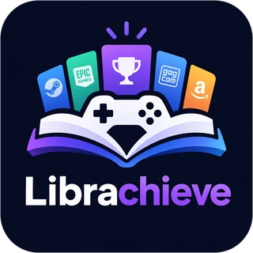

<p align="center"></p>

# Librachieve

Gestor de biblioteca personal de videojuegos: importa tus juegos de Steam, Epic, GOG y Amazon, organízalos por categorías y consulta tus estadísticas.

## Arranque rápido

Requisitos: Docker Desktop.

```bash
cp .env.example .env        # rellena las claves (ver abajo)
docker compose -f infra/docker-compose.yml up -d --build
```

- App: http://localhost:5173
- Documentación de la API: http://localhost:5173/api/docs
- GraphQL (GraphiQL): http://localhost:5173/graphql

Las migraciones se aplican solas al arrancar el backend.

## Claves externas

| Variable | Para qué | Dónde se consigue |
|---|---|---|
| `STEAM_API_KEY` | Importar la biblioteca de Steam y el avatar/nombre | https://steamcommunity.com/dev/apikey |
| `IGDB_CLIENT_ID` / `IGDB_CLIENT_SECRET` | Portadas, géneros, fechas y descripciones | Crea una app en https://dev.twitch.tv/console/apps |
| `SECRET_KEY` | Firma de los JWT | Cualquier cadena aleatoria de 32+ caracteres |

Sin estas claves la app funciona igual: se puede iniciar sesión con Steam y hacer importaciones manuales, pero no habrá sincronización con Steam ni metadatos. Cuando añadas las claves de IGDB, los juegos sin metadatos se completarán en la siguiente importación.

## Arquitectura

```
navegador ──► Vite (dev) / Ingress (k8s) / CloudFront (prod)
                 ├── /            → SPA React
                 ├── /api/*       → FastAPI (REST)
                 └── /graphql     → FastAPI (Strawberry, listados con filtros)
FastAPI ──► PostgreSQL (fuente de verdad)
        └─► Redis (caché IGDB 24h, refresh tokens, cola ARQ) ◄── worker ARQ (sync Steam, IGDB)
```

- **Sesión:** JWT de acceso de 15 min en memoria + refresh token rotatorio en cookie `httpOnly`, guardado en Redis y revocable.
- **Steam:** inicio de sesión con OpenID 2.0; la biblioteca se lee con `GetOwnedGames`. El usuario debe tener los «Detalles de juegos» como públicos en Steam.
- **Importación manual:** JSON o CSV con columna `title`/`name` y, opcionalmente, `playtime_minutes`/`hours`, `status`, `last_played`.

## Kubernetes (staging con Minikube)

```bash
minikube start && minikube addons enable ingress
eval $(minikube docker-env)                       # en PowerShell: minikube docker-env | Invoke-Expression
docker build -f backend/Dockerfile -t librachieve-backend:latest .
docker build --target prod -t librachieve-frontend:latest frontend
cp infra/k8s-secret.example.yaml infra/k8s/secret.yaml   # rellenar (está en .gitignore)
kubectl apply -f infra/k8s/
# añade "<minikube ip> librachieve.local" al fichero hosts
```

## Producción (Oracle Cloud, gratis)

Todo corre en una sola máquina virtual del plan «Always Free» de Oracle Cloud (ARM A1 o, mientras no
haya hueco, la AMD E2.1.Micro de 1 GB) con
`infra/docker-compose.prod.yml`:

- **Caddy** sirve la web y redirige `/api` y `/graphql` al backend, con HTTPS automático (Let's Encrypt).
- **backend + worker + PostgreSQL + Redis**, igual que en desarrollo.
- **backup**: copia diaria comprimida de la base de datos (se guardan 14 días).

Puesta en marcha (una vez): `bash infra/server-setup.sh` en el servidor (Docker, cortafuegos, swap y
actualizaciones automáticas), copiar el `.env` de producción y arrancar:

```bash
docker compose -f infra/docker-compose.prod.yml --env-file .env pull
docker compose -f infra/docker-compose.prod.yml --env-file .env up -d --no-build
```

Variables del `.env` de producción: `DOMAIN`, `SECRET_KEY`, `POSTGRES_PASSWORD`, `STEAM_API_KEY`,
`IGDB_CLIENT_ID`, `IGDB_CLIENT_SECRET`.

Las imágenes (amd64 y arm64) las construye GitHub Actions y las publica en GHCR, así el servidor no
compila nada. `.github/workflows/deploy.yml` despliega solo cada push a `main` con el CI en verde
(variables `DEPLOY_HOST`, `DEPLOY_USER`, `DEPLOY_DOMAIN` y el secreto `DEPLOY_SSH_KEY`).

Restaurar una copia: `gunzip -c librachieve-FECHA.sql.gz | docker compose -f infra/docker-compose.prod.yml exec -T postgres psql -U librachieve librachieve`.

## Otras tiendas (Epic, GOG, Amazon…)

No tienen API pública, así que se importan con un fichero JSON/CSV. Lo más cómodo es Playnite con un
complemento exportador de biblioteca: el fichero indica la tienda de cada juego y Librachieve lo
reparte solo. Volver a importar actualiza sin duplicar.

## App para Windows y Android

La web es una PWA: desde Chrome o Edge se instala como app (Ajustes → «Instalar app», o el menú del
navegador) con su icono y ventana propios, y se actualiza sola con cada despliegue. En el móvil usa una
barra de pestañas abajo. El service worker (`frontend/public/sw.js`) no guarda nunca datos de la API:
solo los ficheros de la web y una página de «Sin conexión». Para probarlo en local hace falta la
build de producción: `cd frontend && npm run build && npm run preview` (puerto 4173, con el mismo
proxy a la API).

## Desarrollo

Consulta [CLAUDE.md](CLAUDE.md) para las reglas del proyecto y los comandos de tests, migraciones y administración.
